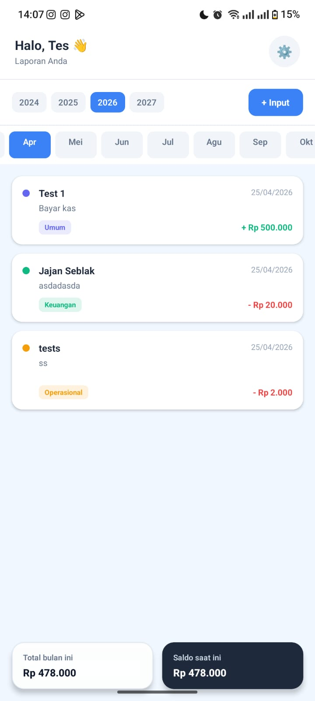

# RN_test

Proyek mobile app berbasis React Native + Expo dengan `expo-router` (file-based routing).

## Preview



## Teknologi

- Expo
- React Native
- TypeScript
- Expo Router
- EAS (Expo Application Services)

## Struktur Utama

- `app/` halaman dan routing aplikasi
- `components/` komponen reusable
- `services/` logic service (storage, user, spreadsheet)
- `types/` definisi tipe TypeScript
- `constants/` konstanta tema
- `hooks/` custom hooks
- `android/` native Android project

## Menjalankan Project

1. Install dependency:

```bash
npm install
```

2. Jalankan Expo dev server:

```bash
npx expo start
```

3. Jalankan di Android (opsional):

```bash
npx expo run:android
```

## Script Penting

- `npm run start` menjalankan Expo
- `npm run android` menjalankan build Android via Expo
- `npm run web` menjalankan versi web
- `npm run lint` menjalankan ESLint
- `npm run reset-project` reset starter project

## Build & Distribusi (EAS)

Inisialisasi EAS sudah dilakukan. Untuk build, gunakan contoh berikut:

```bash
npx eas build --platform android
```

Pastikan sudah login ke akun Expo dan konfigurasi environment sudah sesuai sebelum build release.
